<div align="center">



<br><br>

<a href="https://github.com/LiciaMor18?tab=followers"></a>


</div>

<br>

## 🧙 Character sheet

<div align="center">
  
</div>

<br>

## 🎒 Inventory

<div align="center">


</div>

<br>

## 📜 Quest log

| Status | Quest | Reward |
|:---:|---|:---:|
| ✅ | **[HW2](https://github.com/LiciaMor18/HW2)** — Operating Systems group project in C, built as a party of three | `+500 XP` |
| ⚔️ | **[SapsatProject_2026](https://github.com/LiciaMor18/SapsatProject_2026)** — Python project, still in progress | `+400 XP` |
| 📚 | **[UniNotes](https://github.com/LiciaMor18/UniNotes)** — university notes with Obsidian and Typst (side quest) | `+1 wisdom` |
| 🔒 | **Lock** — unlocks at the end of the main story | `???` |

> [!TIP]
> Got an idea for a side quest? [Open an issue](https://github.com/LiciaMor18/LiciaMor18/issues/new) and suggest it, I'd love to hear it!

<br>

## 📊 Battle log

<div align="center">
  
  
</div>

<br>

## 🐍 The commit snake

<div align="center">
  <picture>
    <source media="(prefers-color-scheme: dark)" srcset="https://raw.githubusercontent.com/LiciaMor18/LiciaMor18/output/github-snake-dark.svg">
    
  </picture>
</div>

<br>

<details>
<summary>🗝️ <b>You found a locked door… want to open it?</b></summary>

<br>

```
         _______________________
        /                      /|
       /______________________/ |
       |                      | |
       |  ◆   TREASURE   ◆   | |
       |       ________       | |
       |      |  ____  |      | /
       |______|_|____|_|______|/
```

**🎉 Well done, explorer! You found the secret room.** &nbsp; `+500 XP`

</details>

<br>

<div align="center">
  <sub>⌨️ Game saved · made with markdown, SVG and way too much coffee · press <kbd>★</kbd> to continue</sub>
</div>
